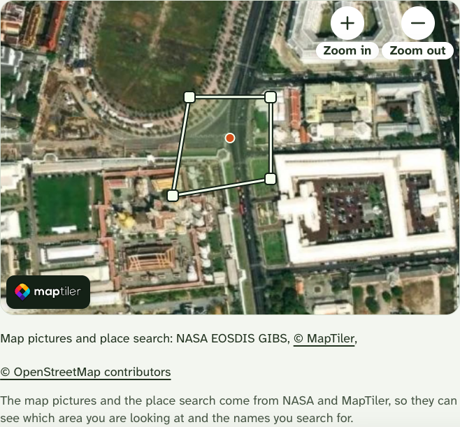
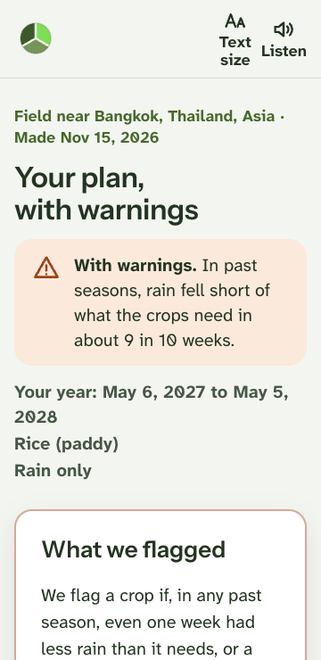
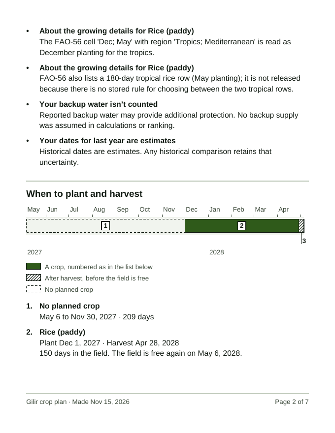
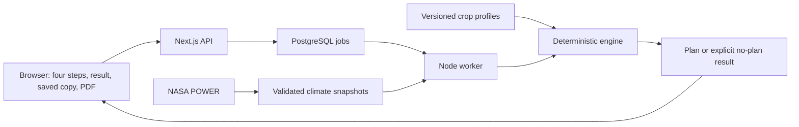

# Gilir

**Plan a year of crops, checked against 25 years of NASA weather.**

Gilir is our entry for the **NASA Space Apps Challenge 2026** hackathon, in the challenge
**[Field Shift: Adapting Farms with NASA Data](https://www.spaceappschallenge.org/2026/challenges/field-shift-adapting-farms-with-nasa-data/)**.

A farmer marks a field, picks the crops for the coming year and says when the field is ready.
Gilir replays each possible planting calendar against past seasons of NASA rainfall and weather for that place.
It answers with one planting calendar and the weeks where rain fell short, or with the specific reason it cannot make a plan.

**Live site:** [gilir-web-production.up.railway.app](https://gilir-web-production.up.railway.app)

<p>
  
  
  
</p>

*The public site on 15 November 2026: the NASA globe, a test field marked over satellite imagery, and a real result on a phone.
The field is a test box at a public place in Bangkok, not a farm.*

## The problem

A crop can fit on the calendar and still meet dry weeks when it needs the most water.
Rainfall is shifting, and a planting date that worked for a farmer's parents may no longer be the safe one.
The record that could show this is public, but it comes as decades of daily numbers on a grid, which is no use to a farmer holding a phone in a field.

Gilir turns that record into one answer a farmer can read: what to plant, when, and what past seasons say to watch.

## What a farmer does

The interface is designed for accessibility, because farmers are on average an older group, and for low-cost phones in bright sun. There is no account, no sign-in and no landing page: the site opens on the first question.

1. **Where is your farm?** Turn the NASA globe or search for a place, then fit a box to the field. A position can be typed instead, and a list of corners works with no map at all.
2. **Which crops do you want to grow?** Pick from 40 food crops. Every plan includes every crop picked.
3. **Where does your water come from?** Rain only, rain plus backup water, or not sure.
4. **Your rotation.** The day the field is ready, and what grew there in the last 12 months. "I don't remember" is an accepted answer.

Then the farmer taps **Make my plan** and gets one of these:

| Result | What it means |
| --- | --- |
| Your plan | A planting calendar for the year that passed every check Gilir could run |
| Your plan, with warnings | A calendar that fits, with what fell short of a crop's needs in past seasons |
| We can't make a plan yet | Growing details or weather records are missing for this place or crop, and the page says which |
| Your crops don't all fit in one year | No calendar fits, and the page says whether the crops need too many days or their planting times collide |
| We couldn't finish the search | The search hit its limit first. This is not proof that the crops cannot fit |
| Something went wrong | The service failed. The farmer's answers are kept |

The result stays on the phone and reopens with no connection. It downloads as a PDF with the same plan, warnings and source period.



*Page 2 of a real downloaded PDF: the year's timeline and each period with its dates.*

## Designed for accessibility

In much of the world farmers are, on average, older than most people who use apps. The interface is designed for older eyes and hands, which may not suit small text and small buttons.

| Need | What the interface does |
| --- | --- |
| Reading small text | Body text is 20 px and the smallest text is 18 px. A **Text size** setting offers Normal, Large and Largest, and spacing and buttons grow with it |
| Bright sun and weak contrast | Dark text on a light page, a **High contrast** setting with black text on white and thicker edges, and a dark theme that follows the phone |
| Reading is tiring or hard | A **Listen** button reads the page aloud. Sentences are short and plain, with one question per page |
| Tapping accurately | Main buttons are 64 px tall and no target is smaller than 48 px |
| Telling things apart without colour | Every status has an icon and words, and timeline bars differ by pattern, so they read in grayscale and in print |
| No mouse or no touch | Every step works by keyboard alone, with a visible focus ring |
| An old or cheap phone | The journey works with no WebGL through a drawing and a list of corners, and motion runs only when the phone allows it |

The body typeface is Atkinson Hyperlegible Next, which was drawn for legibility. The interface has not yet been tested with a screen reader or on a real low-cost phone.

## Where NASA data enters

| NASA data | Fields | What Gilir does with it |
| --- | --- | --- |
| [POWER](https://power.larc.nasa.gov/docs/services/api/temporal/daily/) meteorology | `T2M`, `T2M_MIN`, `T2M_MAX`, `RH2M`, `WS2M`, `PS` | Temperature, humidity, wind and pressure for reference evapotranspiration |
| POWER solar radiation | `ALLSKY_SFC_SW_DWN` | Solar energy for reference evapotranspiration |
| IMERG precipitation through POWER | `IMERG_PRECTOT` | Daily rainfall, compared with what each crop needs |
| [GIBS](https://nasa-gibs.github.io/gibs-api-docs/) Blue Marble imagery | Map tiles | The globe a farmer turns to find the farm |

Gilir fetches daily records for the field's grid cell and builds up to 25 past seasons from them. At least 15 complete seasons are required.
FAO-56 Penman-Monteith gives daily reference evapotranspiration, `ET0`, and released crop coefficients give each crop's demand, `ETc = Kc × ET0`.
Stage lengths, planting periods and crop coefficients come from [FAO-56 Tables 11 and 12](https://www.fao.org/4/x0490e/x0490e0b.htm).
For each calendar and each past season, Gilir compares rainfall with crop demand in rolling seven-day windows.

Every result records its sources, units, grid cell, missing days and method versions, and **View details** shows them.
A field outline does not make NASA's grid finer: every farm in the same cell shares the same records, and the page says so.
See [POWER's meteorological sources](https://power.larc.nasa.gov/docs/methodology/data/sources_meteorology/) and the [product definitions in the code](src/server/climate/products.ts).

## How a plan is chosen

The engine freezes the crop profiles and weather records for the request. It searches calendars that respect each crop's planting period, grow one crop at a time and fit inside one year from the chosen date.
It prefers calendars without warnings, then compares candidates in one fixed order, lower winning. The farmer does not choose the order.

| Order | What Gilir compares |
| --- | --- |
| 1 | How often rain fell below estimated crop demand, in rolling seven-day windows |
| 2 | The average size of that shortfall |
| 3 | Days without a planned crop |
| 4 | The longest stretch without a planned crop |

Rainfall is the only water supply in the calculation. Saying there is backup water changes the explanation, never the numbers or the ranking.
The same request always gives the same result, and there is no language model in the running product.
A search that stops at its limit does not establish the best possible calendar, and the result says so.

## Try it

Open [gilir-web-production.up.railway.app](https://gilir-web-production.up.railway.app). These inputs gave a plan in our checks:

| Place | Crops | Field ready | Result |
| --- | --- | --- | --- |
| Madrid, Spain | Radish and Barley (grain) | 1 March 2027 | Plan with warnings: radish from 1 March, barley from 12 April |
| Bangkok, Thailand | Rice (paddy) | 6 May 2027 | Plan with warnings: rice planted on 1 December |
| Boise, USA | Common bean (dry grain) | 1 June 2027 | Plan with warnings: beans planted on 1 June |

Growing details are regional, so the place matters. The released catalogue has details for 34 of the 40 crops in Madrid and 28 in Cairo, but for 2 in Bangkok and Java and for none in São Paulo or Sydney.
Where a picked crop has none, Gilir says so and makes no plan.

## What is verified

| Evidence | What it establishes |
| --- | --- |
| [Hosted acceptance](docs/evidence/I3/hosted.md) | On the public site, 17 browser cases passed at phone and desktop widths on 15 November 2026: the full journey to a real result, reload during planning, a saved result reopened with the server refused, the PDF, keyboard-only use, no WebGL, missing crop evidence, and a refused request |
| [Assembled journey](docs/evidence/I3/README.md) | The same cases on a local run of the real stack, with screenshots, the downloaded PDFs and a recording |
| [Live runtime acceptance](docs/evidence/I1/README.md) | 28 checks with real NASA data, HTTP, PostgreSQL, separate workers and restart recovery |
| [Science cases](docs/evidence/I2/README.md) | Six actual-engine cases on recorded NASA observations, with identical hashes on repeat and an independent FAO calculation that matches Boise's per-season numbers |
| [Crop-source review](docs/evidence/E1/README.md) | 75 source-reviewed profiles for 40 food crops, with applicability decisions and withheld rows |
| [Climate coverage](docs/evidence/X2/README.md) and [reference calculations](docs/evidence/X3/README.md) | More locations and independent metric examples |
| Interface evidence: [input flow](docs/evidence/F1/README.md), [field picker](docs/evidence/F2/README.md), [results](docs/evidence/F3/README.md), [saved work and PDF](docs/evidence/F4/README.md) | Browser runs of each part at 360 and 1280 px, with screenshots |

`npm run check` passes with 1,765 tests. The hosted site runs a reviewed, pinned release, so `main` can be ahead of it.
These checks do not establish harvest success or an agronomist's approval. The test fields are illustrative places, not surveyed farms.

## Limits

- **Past seasons, not a forecast.** A plan compares calendars against history. It does not predict next season or a yield.
- **Coverage is regional and narrow.** See the counts above. Source review does not establish worldwide agronomic coverage or field validation.
- **Planting periods are strict.** Each crop may be planted only in the one or two months its source gives. Two crops often cannot both fit in one year: rice and soybean in Bangkok return "don't all fit". In our runs every real plan came back with warnings.
- **Rain only.** The water check leaves out soil-water storage, runoff, irrigation volumes and the standing water a rice paddy needs.
- **Heat and cold are not assessed.** Temperature feeds evapotranspiration, but the release has no heat, frost or crop-order rules yet, and the result says "not assessed".
- **Not measured.** Gilir does not measure soil health or assess pests and weeds. SMAP soil moisture, vegetation imagery and climate projections are not integrated.
- **English only**, with metric units.

## Privacy

There is no account. The field's corners stay in the browser until the farmer asks for a plan.
A plan request is anonymous and protected by a random token sent in a header, never in an address.
The browser deletes its request from the server once it holds the result, and the server's cleanup removes finished requests after 24 hours.
Map pictures come from NASA and MapTiler, so they can see which area is being viewed, and the page says this beside the map.

## Run locally

Use Node.js 24 and Docker Compose. Run commands from the repository root.

```sh
git clone https://github.com/Quantomz/gilir.git
cd gilir
npm ci
cp .env.example .env
```

Edit `.env`. Choose a local `POSTGRES_PASSWORD` and an available `POSTGRES_PORT`, and match them in `DATABASE_URL` and `TEST_DATABASE_URL`. Keep credentials out of Git.

```sh
docker compose up -d --wait postgres
npm run migrate
npm run dev
```

In a second terminal, start the worker. It needs `WORKER_ID`; the example file's `GILIR_WORKER_ID` does not set it.

```sh
WORKER_ID=local-worker npm run worker
```

Open [http://localhost:3000](http://localhost:3000) and follow the four steps.
With no `NEXT_PUBLIC_MAPTILER_KEY`, the globe still shows NASA imagery and the farm is found by typing a position such as `40.4, -3.7`. The key adds place-name search and satellite close-ups.

Replay the science cases against committed NASA snapshots, with no database and no provider requests:

```sh
npx vitest run tests/integration/science
```

Run the repository checks, the production build and the browser journey on fixtures:

```sh
npm run check
npm run build
npx playwright test -c tests/integration/browser/playwright.config.ts
```

The same browser journey runs against the real stack with `I3_LIVE=1`; see the [journey evidence](docs/evidence/I3/README.md).
Database-backed suites need `TEST_DATABASE_URL`, `B3_TEST_DATABASE_URL` and `I1_TEST_DATABASE_URL`, and skip without them. The I1 suites need a dedicated database named `gilir_i1`; the [runtime guide](docs/evidence/I1/README.md#reproduce) describes it. The build downloads Google Fonts and needs network access.

## Architecture



React and Tailwind draw the interface, MapLibre draws the globe, and the result is stored in the browser's IndexedDB.
Jobs outlive HTTP requests, and frozen inputs and source identities keep retries reproducible.
See the [specification](spec.md), [contracts](docs/contracts.md), [build plan](docs/build-plan.md) and [contributor instructions](AGENTS.md). Planning documents keep some historical status.

## Team and acknowledgments

| Contributor | Work |
| --- | --- |
| [@kyusuku](https://github.com/kyusuku) | Backend, NASA ingestion, durable runtime, deterministic search and hosting |
| [@yslee1106](https://github.com/yslee1106) | Crop registry, climate metrics and scientific verification |
| [@Quantomz](https://github.com/Quantomz) | Farmer interface: field picker, the four steps, results, saved work, PDF and the browser journey tests |

Thanks to NASA POWER, IMERG, GIBS and FAO for the cited data and methods, and to MapTiler and OpenStreetMap contributors for place search and satellite close-ups.
Acknowledgment does not imply endorsement by NASA or anyone else. The team used AI-assisted development tools.

Code is licensed under [Apache 2.0](LICENSE). Referenced data and publications keep their own terms.
