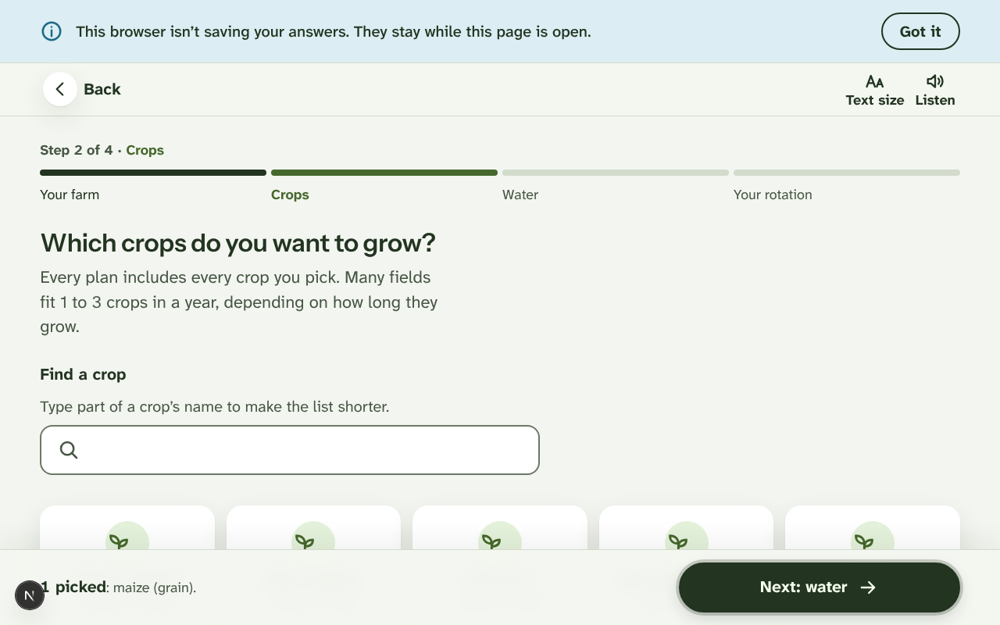
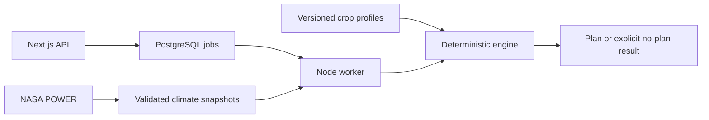

# Gilir

**Plan a year of crops with NASA climate history.**

A crop can fit on a calendar and still face dry weeks at peak water demand.
Gilir compares crop sequences and planting dates against historical NASA climate records.
It returns one explained plan or a specific reason it cannot produce one.
Every selected crop must fit, one at a time, within a year of the chosen start date.

Built for the 2026 NASA Space Apps Challenge,
[Field Shift: Adapting Farms with NASA Data](https://www.spaceappschallenge.org/2026/challenges/field-shift-adapting-farms-with-nasa-data/).

[Watch the phone walkthrough](docs/evidence/F1/flow-360.webm) ·
[Watch the desktop walkthrough](docs/evidence/F1/flow-1280.webm) ·
[Inspect calculated results](docs/evidence/I2/released-run.json) ·
[Run locally](#run-locally)



*Fixture preview with a synthetic field, released crop list, and mocked jobs.
The recordings show onboarding and editable history.*

## What works today

The calculator, NASA ingestion, PostgreSQL job service, worker, and four input pages are implemented.
The current catalogue contains **75 source-reviewed profiles for 40 food-crop purposes**.
Gilir enforces the release's planting windows as hard constraints. Profiles without a published window remain windowless.

The field picker, results screen, browser recovery, PDF export, and complete browser journey remain unfinished.
The [older hosted preview](https://gilir-web-production.up.railway.app) still returned
`v1-empty` with zero catalogue entries on 15 November 2026. Start with the recordings and calculator cases.

## How a plan is chosen

The engine freezes crop profiles and weather snapshots for the submitted location, crops,
start date, water answer, and optional history. It searches calendars that respect planting
windows and avoid overlap, then replays them against the same historical seasons.

The engine first prefers calendars without environmental flags. It then compares candidates
in one fixed order, with lower values winning.

| Order | What Gilir compares |
| --- | --- |
| 1 | Frequency of rainfall falling below estimated demand in rolling seven-day windows |
| 2 | Average relative size of that shortfall |
| 3 | Days without a planned crop |
| 4 | Longest gap without a planned crop |

If every assessed calendar has environmental flags, Gilir returns a warning plan.
Missing evidence produces insights without a plan. Calendar conflicts and unfinished searches
have distinct result states. Bounded search does not establish a global optimum.

Rainfall is the only modeled water supply. Reporting backup water changes the explanation, not the
assumed supply or ranking. Calculations and explanations are deterministic, with no runtime LLM.

## Where NASA data enters the calculation

Gilir retrieves daily UTC records through the
[NASA POWER daily API](https://power.larc.nasa.gov/docs/services/api/temporal/daily/).

| NASA data | Fields | Use |
| --- | --- | --- |
| POWER meteorology | `T2M`, `T2M_MIN`, `T2M_MAX`, `RH2M`, `WS2M`, `PS` | Temperature, humidity, wind, and pressure for reference evapotranspiration |
| POWER solar radiation | `ALLSKY_SFC_SW_DWN` | Solar energy for reference evapotranspiration |
| IMERG precipitation through POWER | `IMERG_PRECTOT` | Rainfall compared with estimated crop demand |

FAO-56 Penman-Monteith gives daily reference evapotranspiration, `ET0`.
Released crop coefficients give estimated demand, `ETc = Kc × ET0`.
Stage lengths, planting periods, and crop coefficients come from
[FAO-56 Tables 11 and 12](https://www.fao.org/4/x0490e/x0490e0b.htm).
Gilir separately assumes seven days to clear and prepare the field after harvest.
The engine evaluates rolling seven-day rainfall-demand shortfalls across up to 25 historical
seasons. At least 15 complete seasons are required under the current release policy.

Snapshots retain units, conversions, missingness, native cells, provenance, and available versions.
Unreported versions remain unavailable. Field outlines do not improve NASA's native grid resolution.
See [POWER meteorological sources](https://power.larc.nasa.gov/docs/methodology/data/sources_meteorology/)
and the [implemented product definitions](src/server/climate/products.ts).

## Reproducible results

These direct-engine cases use real recorded NASA observations and release
`fao56-hard-windows-2026-11-15`. All six had 25 usable seasons and identical hashes on repeat calculation.
The locations are illustrative, not surveyed farms.

| Case | Observed result |
| --- | --- |
| Boise, dry beans | Warning plan. Occupancy runs from 1 June through 8 September 2027. |
| Madrid, radish and barley | Warning plan. Planting starts on 1 March and 12 April 2027, respectively. |
| Madrid, wheat and maize | No calendar fit under the released planting windows. |
| Boise, maize, dry beans, and wheat | No calendar fit. Required durations exceed the one-year horizon. |
| Bangkok dry beans; Ibadan maize | Missing applicable crop profiles. No plan. |

Both plans respect their planting windows and disclose rainfall-demand mismatch.
The [science report](docs/evidence/I2/README.md) includes an independent FAO calculation
that matches Boise's per-season metrics. These checks do not establish harvest success or agronomist approval.

| Evidence | What it establishes |
| --- | --- |
| [Current-release science cases](docs/evidence/I2/README.md) | Six actual-engine cases, repeat hashes, and independent recomputation |
| [Live runtime acceptance](docs/evidence/I1/README.md) | 22 passing checks with real NASA, HTTP, PostgreSQL, separate workers, and restart recovery. Uses the **earlier** `fao56-reviewed-2026-11-15` release. |
| [Crop-source review](docs/evidence/E1/README.md) | Published parameters, applicability decisions, withheld rows, and release history |
| [Climate coverage](docs/evidence/X2/README.md) and [reference calculations](docs/evidence/X3/README.md) | Additional location checks and independent metric examples |
| [Interface evidence](docs/evidence/F1/README.md) | 51 Chromium fixture cases covering input flows, keyboard controls, and failures |

Runtime and science evidence cover different paths and releases. Neither proves a deployed browser journey.

## Run locally

Use Node.js 24 and Docker Compose. Run commands from the repository root.

```sh
git clone https://github.com/Quantomz/nefalos_nasa_hackathon.git
cd nefalos_nasa_hackathon
npm ci
cp .env.example .env
```

Edit `.env`. Choose a local `POSTGRES_PASSWORD` and an available `POSTGRES_PORT`.
Match them in `DATABASE_URL` and `TEST_DATABASE_URL`. Keep credentials out of Git.

```sh
docker compose up -d --wait postgres
npm run migrate
npm run dev
```

In a second terminal, start the worker.

```sh
WORKER_ID=local-worker npm run worker
```

The worker requires `WORKER_ID`; the example file's `GILIR_WORKER_ID` does not set it.
Open [the fixture lab](http://localhost:3000/dev/fixtures) for onboarding with a seeded field.
Field selection at `/` is unfinished. The lab uses invented data and is unavailable in production.

Replay the science cases against committed NASA snapshots without PostgreSQL or new provider requests.

```sh
npx vitest run tests/integration/science
```

Run the repository checks and production build.

```sh
npm run check
npm run build
```

Database-backed suites require `TEST_DATABASE_URL`, `B3_TEST_DATABASE_URL`, and
`I1_TEST_DATABASE_URL` in the process environment. Without them, those suites skip.
The I1 suites require a dedicated database named `gilir_i1`.
The [runtime reproduction guide](docs/evidence/I1/README.md#reproduce) describes the separate
live NASA opt-in and dedicated test database. The build downloads Google Fonts and needs network access.

## Architecture and next steps



React and Tailwind power the interface. Durable jobs outlive HTTP requests.
Frozen inputs and source identities keep retries reproducible.

The next delivery work is the [field picker](https://github.com/Quantomz/nefalos_nasa_hackathon/issues/2),
[results screen](https://github.com/Quantomz/nefalos_nasa_hackathon/issues/3),
[local save and PDF](https://github.com/Quantomz/nefalos_nasa_hackathon/issues/4), and
[complete browser acceptance](https://github.com/Quantomz/nefalos_nasa_hackathon/issues/13).
See the [specification](spec.md), [contracts](docs/contracts.md), [build plan](docs/build-plan.md),
and [contributor instructions](AGENTS.md). Planning documents retain some historical status.

## Limits and responsible interpretation

Historical replay is a planning comparison, not a forecast or yield prediction.
The rainfall screen excludes soil-water storage, runoff, irrigation volumes, and paddy losses.
Temperature contributes to `ET0`, but the current release has no operational heat, frost, or
rotation rules. Heat and frost suitability remain unassessed. Source review does not establish worldwide
agronomic coverage or field validation.

Gilir does not measure soil health or assess pests and weeds. Soil benefits and farmer outcomes
need future field evaluation. SMAP, vegetation imagery, and future climate projections are not integrated.

## Team and acknowledgments

| Contributor | Work |
| --- | --- |
| [@kyusuku](https://github.com/kyusuku) | Backend, NASA ingestion, durable runtime, and deterministic search |
| [@yslee1106](https://github.com/yslee1106) | Crop registry, climate metrics, and scientific verification |
| [@Quantomz](https://github.com/Quantomz) | Farmer interface and onboarding |

Thanks to NASA POWER, IMERG, and FAO for the cited data and methods.
Acknowledgment does not imply endorsement. The team used AI-assisted development tools.

Code is licensed under [Apache 2.0](LICENSE). Referenced data and publications retain their own terms.
