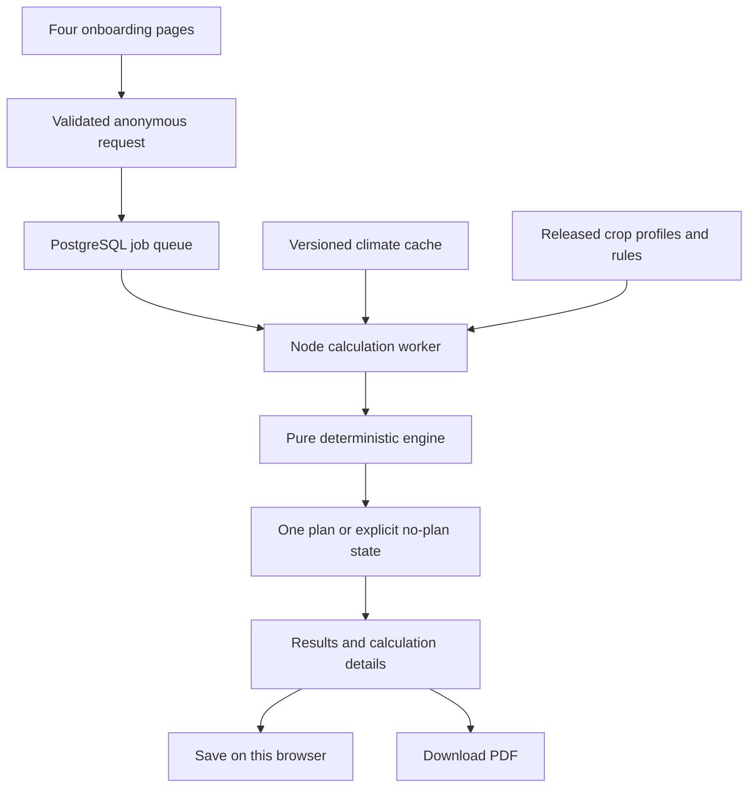

# Gilir MVP specification

Version 1.1. Written 14 November 2026. Revised the same day to remove the farmer-selected priority and the pest and weed rule registry. Every run now uses one fixed ranking.

This document records the completed requirements interview and defines the first implementation. It supersedes the earlier posters where they describe an LLM, three suggested plans, a Java-only scope, or a multiyear transition roadmap.

The product decisions below are confirmed. Numerical search settings, data completeness thresholds, formulas for comparison, and supporting architecture are implementation defaults selected for this specification. They are versioned policies, not claims of scientific validation. This document specifies a system to build. It does not establish that the crop catalogue or backend already exists.

## 1. Product contract

Gilir gives a farmer one crop rotation plan for one year, ranked by one fixed comparison order that puts rainfall-demand mismatch first. It compares possible sequences and planting dates using historical climate data and source-backed crop parameters. Generation, scoring, selection, and explanations are deterministic. No runtime LLM is involved.

| Requirement | Agreed behavior |
| --- | --- |
| Geography | Worldwide location selection. No country allowlist. Data and crop-profile coverage determine which calculations are available. |
| Crops | A defined catalogue of seasonal crops and seasonal cover crops. Every selected crop appears at least once. Suitable repeats are allowed. |
| Field | The entire marked area follows one sequence. One crop occupies the field at a time. |
| Horizon | One year from the farmer's chosen field-available date. All selected crops must fit inside that year. |
| Result | One suggested plan, ranked by the fixed water-first comparison in section 6.5. The farmer does not choose a priority. The existing rotation can win when eligible. |
| Water | All plans use rainfall alone. Reported backup water provides additional protection but contributes no assumed supply to calculations. |
| Known poor suitability | Return the best assessed calendar-valid arrangement with a prominent warning. |
| Missing required evidence | Return available insights and the missing-data explanation, with no generated plan. |
| Historical rotation | Optional. Editable planting and harvest endpoints. Approximate dates are allowed. |
| Transition | Explain changes to adopt the one-year plan. No separate two-to-three-year roadmap. |
| Result editing | View-only timeline. Change inputs and regenerate. |
| Platform | Responsive website for phones and desktops. Next.js, Tailwind CSS, and PostgreSQL. |
| Persistence | No accounts. Save on the current browser and download a PDF. |

The MVP excludes fertilizer quantities, costs, yield forecasts, price forecasts, irrigation scheduling, perennial crops, intercropping, simultaneous field subdivisions, and public farm-sharing links.

The output is an estimated planning comparison. Historical replay is not a forecast of next season. A soil-related schedule indicator is not a soil test. The MVP makes no pest or weed assessment.

## 2. Farmer experience

Each onboarding page has one main task, a back control, and one continue action. Previously entered values survive navigation and refresh.

| Page | Farmer action | Stored input |
| --- | --- | --- |
| 1. Find your farm | Search for a place, rotate and zoom the globe, then mark the field. | One field polygon, a point inside it for climate lookup, and a location label. |
| 2. Choose your crops | Select crops from the released catalogue. | Distinct crop-purpose IDs. All are mandatory in the result. |
| 3. Water source | Choose one answer. | `rain_only`, `rain_plus_backup`, or `unsure`. |
| 4. Your rotation | Edit last year's crop bars or skip history. Choose when the field will be available for the new plan. | Historical crop intervals, date precision, history coverage, and planning start date. |

Water labels are "Rain only", "Rain + water when it's dry", and "I'm not sure".

The historical timeline supports adding, removing, moving, and resizing bars. Each bar has a crop name and planting and harvest dates. Tapping an endpoint exposes an accessible date control. Dragging is never the only way to operate the timeline. A short "Dates are approximate" control records uncertainty without adding another page.

Unfilled historical intervals remain unknown unless the farmer marks them as fallow. Skipping history is different from reporting a year of fallow. Historical crops outside the supported catalogue can be recorded as named, unsupported entries. Those entries do not receive invented crop parameters.

The location page uses a rotating globe at low zoom and a usable map for field outlining at high zoom. A 2D map fallback supports devices without the required WebGL capability. Search and drawing stay on the same page. Coordinate entry and vertex editing provide keyboard alternatives. The field polygon is one contiguous management unit. Dateline-crossing geometry is normalized before lookup.

The result page contains the following elements:

- A prominent status and one suggested timeline when a plan can be assessed.
- A plain explanation of why the plan ranked first under the fixed ranking.
- The actual historical period and number of usable seasons.
- Ranking indicators, water and temperature warnings, and unassessed checks.
- A comparison with the existing rotation when a valid comparison is possible.
- Preparation steps and changes in crop order and dates.
- **View details**, **Change inputs**, **Download PDF**, and **Clear saved data**.

The details panel contains data sources, grid sizes, missingness, crop profiles, calculation definitions, score components, assumptions, and search coverage. Information necessary to understand a warning remains visible on the main result page.

Interface defaults are English, metric units, and browser-local date display. Stored dates are unambiguous ISO dates. Layouts work at 360 CSS pixels and desktop widths. Controls have a target size of at least 44 CSS pixels. Statuses have text labels and do not depend on color.

## 3. What the backend needs

The backend combines three independent kinds of information. Climate records describe conditions at a location. Crop profiles describe how a particular crop is represented. Rotation rules describe documented relationships between successive crops. One does not replace the others.

### 3.1 Required farmer data

Required fields are the location, at least one selected crop, water answer, and planning start date. Historical intervals are optional. There are no mandatory soil, fertilizer, irrigation-volume, price, or cultivar questionnaires.

Without a cultivar question, the backend selects an applicable released crop profile and shows that assumption. If no applicable profile exists, the engine reports missing data instead of guessing a cultivar or silently selecting the shortest duration.

### 3.2 Environmental data

| Data | Initial source and fields | Use | Requirement |
| --- | --- | --- | --- |
| Daily precipitation | NASA POWER `IMERG_PRECTOT`, with the underlying IMERG stream and version recorded | Historical rain distribution and rainfall-demand comparisons | Required for all plans |
| Daily temperature | POWER `T2M`, `T2M_MIN`, `T2M_MAX`, degrees C | Reference evaporation and supported temperature checks | Required for all plans |
| Humidity | POWER `RH2M`, percent | Reference evaporation | Required for all plans |
| Wind | POWER `WS2M`, metres per second at 2 m | Reference evaporation | Required for all plans |
| Solar radiation | POWER `ALLSKY_SFC_SW_DWN`, response units converted to MJ per square metre per day | Reference evaporation | Required for all plans |
| Surface pressure | POWER `PS`, response units converted to kPa | Reference evaporation | Required, or a released FAO elevation-based substitute |
| Elevation and latitude | Provider metadata and the lookup coordinate | Radiation and pressure calculations | Required by the selected ET0 method |
| Regional soil context | GAEZ or a separately verified global soil product | Optional context such as mapped soil constraints | Optional. Never a farm soil test |
| Soil moisture | SMAP or GLDAS with product metadata | Optional recent regional wetness context | Optional. Does not initialize an invented farm water balance |
| Vegetation | MODIS, VIIRS, or Landsat with quality masks | Optional historical greenness context | Optional. Does not identify the farmer's crops without a validated classifier |

POWER products have different native grids. Meteorology is commonly 0.5 by 0.625 degrees, solar radiation 1 degree, and IMERG 0.1 degree. These angular grids do not imply a fixed kilometre size everywhere. A precise field boundary does not improve the native climate resolution. The result records each product's cell and resolution. [POWER methodology](https://power.larc.nasa.gov/docs/methodology/)

All weather requests explicitly use UTC. Adapters validate provider units, missing-value markers, time coverage, and parameter availability. Cache keys include the native cell, product version, fields, dates, and time standard. Provider limits apply to retrieval batches. [POWER daily API](https://power.larc.nasa.gov/docs/services/api/temporal/daily/)

IMERG Final is preferred when available for historical research. The adapter records the actual stream returned rather than assuming a POWER field implies a particular release. No change from one rainfall product to another occurs silently. [NASA IMERG guidance](https://gpm.nasa.gov/data/imerg)

ERA5 is a possible later whole-cohort fallback. It is not an automatic day-by-day patch for missing NASA observations. A fallback needs its own adapter validation, units, provenance, and source-comparison checks before release.

### 3.3 Source-backed crop profiles

"Source-backed" means a reviewer checked the parameter against a traceable publication and recorded its applicability. It does not mean the profile has been validated on this farmer's field or certified by an agronomist.

Each released crop profile contains the following fields:

| Group | Required contents |
| --- | --- |
| Identity | Stable crop ID, scientific name, common name, family, food or cover purpose, and profile version |
| Applicability | Crop or cultivar group, production system, relevant geography or climate conditions, and explicit exclusions |
| Timing | Published stage lengths or an explicit duration model, allowable duration range where known, planting constraints, and field-release requirements |
| Crop demand | FAO-compatible `Kc` values and stage interpolation rules with source and management assumptions |
| Temperature | Any supported heat, cold, frost, or development limits, including temperature variable, averaging period, sensitive stage, and units |
| Rotation | Links to applicable crop-sequence rules and preparation templates |
| Provenance | Source URL, document section or table, publication date, extraction date, reviewer, and review status |

FAO-56 provides crop coefficients and growth-stage guidance. Values vary with climate and management. A released profile must state how it uses those tables. FAO Crop Calendar can provide regional calendars, but its published country coverage is incomplete. ECOCROP supplies broad environmental descriptors and is a legacy source. Its annual limits are not daily temperature or weekly rainfall thresholds. [FAO-56 crop coefficients](https://www.fao.org/4/x0490e/x0490e0b.htm), [FAO Crop Calendar](https://cropcalendar.apps.fao.org/?language=en&pagename=%2Fwelcome.do), [FAO ECOCROP](https://www.fao.org/geospatial/data-and-tools/data-portals/ecocrop/en)

The initial curation target is rice, maize, wheat, barley, sorghum, soybean, groundnut, mung bean, cowpea, common bean, sunflower, and potato. This is an implementation target, not a claim that twelve complete profiles are ready. Cover-crop uses of cowpea or mung bean require separate purpose-specific profiles and termination timing. They cannot reuse grain-harvest durations without evidence.

Only released crop-purpose entries are selectable. An entry can be available globally in the catalogue while lacking an applicable profile at a particular farm. Geographic reach does not establish universal agronomic coverage. Paddy rice needs an explicit warning that the screening calculation excludes ponding, seepage, and percolation requirements.

Profile selection follows a stored precedence order. An applicable regional profile outranks an applicable climate-based profile, which outranks an applicable broad published profile. Within a level, the released registry defines precedence explicitly. Profile selection never depends on which profile produces the most attractive plan.

An LLM is not needed to obtain these records. The team can extract them manually from publications into reviewed structured data. An optional offline extraction tool cannot release a profile or substitute its output for the cited source.

### 3.4 Rotation rules

Pest and weed rules are outside the MVP. There is no pest-and-weed priority, no pest-host or weed rule registry, no coverage manifest, and no rule-breach or break-shortfall metric. Results make no claim about pest or weed effects. A shared crop family does not prove that two crops share a consequential pest, so no crop-family proxy is shown in place of the removed assessment. [FAO diversification guidance](https://www.fao.org/conservation-agriculture/in-practice/species-diversification/en/)

The registry may release explicit physical or regulatory sequence rules, such as a documented prohibition on planting one crop directly after another. Each rule names the affected crops, applicable region or conditions, source, and review. These rules are hard structural constraints under section 6.1. They are not scores. No conclusion is made about an unknown predecessor.

## 4. Historical climate and data quality

Climate-pattern data is available. The MVP derives seasonal patterns from daily historical records. It does not require an LLM to identify the local climate.

The default target is the most recent 25 complete historical replay seasons available before the run's frozen data cutoff. A replay season begins on the planning start month and day in a historical year. It follows consecutive actual weather dates for the full plan length, including a December crossing. A February 29 anchor maps to February 28 in a non-leap year. Leap-day handling is recorded in the method version.

The same historical seasons are used for every candidate and the eligible baseline in one run. This avoids giving one plan easier weather. The actual number and date ranges are displayed. The backend never fills a "25 years" label with incomplete records.

The default completeness gate is 15 fully usable seasons out of the target 25. Fifteen is a product release setting, not a scientific sufficiency claim. A usable season has all required daily variables for the entire planning horizon, plus any lookback required by an activated rule. Missing required days exclude that season. Missing precipitation is never treated as zero. The first version performs no statistical gap filling.

If fewer than 15 seasons remain after approved source handling, the result contains available insights and `insufficient_data`. Optional soil moisture or vegetation gaps do not shorten the core climate cohort.

The backend can calculate these climate insights independently of the plan:

- Monthly rainfall totals and their median, 10th percentile, and 90th percentile across eligible years.
- Monthly mean temperature and distributions of daily minimum and maximum temperatures.
- The longest dry spell in each replay season. The display default defines a dry day as less than 1 mm of rain, with that definition visible.
- Historical wet-day frequency by month. The display default defines a wet day as at least 1 mm. It is a historical fraction, not tomorrow's probability of rain.
- Rainfall and reference evaporation by month, with the source period and missingness.

The MVP does not apply Java's rain-onset rule worldwide. A regional onset diagnostic can be added only with an applicable published rule. Monsoon onset, two wet seasons, and temperate planting windows require different interpretations. Future climate projections and climate-trend significance tests are outside the initial ranking engine.

GAEZ can supplement modeled agroclimatic context. It does not supply plot-specific soil measurements or prove that a suggested rotation is locally optimal. [FAO GAEZ](https://www.fao.org/gaez/en)

## 5. Deterministic calculations

The first release uses a rainfall-demand screening model and schedule-based indicators. It does not run a calibrated crop-yield model or a complete farm water balance.

### 5.1 Reference evaporation and crop demand

Daily reference evapotranspiration follows FAO-56 Penman-Monteith:

```text
ET0 = [0.408 * Δ * (Rn - G) + γ * 900 / (T + 273) * u2 * (es - ea)]
      / [Δ + γ * (1 + 0.34 * u2)]
```

`ET0` is mm per day. `T` is mean air temperature in degrees C. `u2` is wind at 2 m. `Rn` and `G` are MJ per square metre per day. `es` and `ea` are kPa. `Δ` is kPa per degree C, and `γ` is the psychrometric constant. For the daily calculation, `G = 0`. Valid negative computed ET0 values are clamped to zero. Invalid inputs are missing data, not zeros. [FAO reference ET0](https://www.fao.org/4/X0490E/x0490e06.htm)

The meteorology module implements FAO's vapor-pressure, radiation, and pressure conversions. The initial humidity approximation uses mean relative humidity:

```text
e0(T) = 0.6108 * exp(17.27 * T / (T + 237.3))
es = [e0(Tmax) + e0(Tmin)] / 2
ea = RHmean / 100 * es
Δ = 4098 * e0(Tmean) / (Tmean + 237.3)^2
γ = 0.000665 * pressure_kPa
Rn = net_shortwave_radiation - net_longwave_radiation
```

The remaining radiation calculations use the FAO equations for latitude, day of year, elevation, clear-sky radiation, and daily extrema in kelvin. The humidity approximation and radiation assumptions are recorded in the method metadata. Numerical validation uses the FAO examples before release. [FAO meteorological parameters](https://www.fao.org/4/X0490E/x0490e07.htm)

For crop occurrence `j` on day `t`:

```text
ETc[j,t] = Kc[j,t] * ET0[t]
```

`Kc` is constant in initial and middle stages and interpolated linearly through the released development and late-stage values. Stage intervals and endpoint conventions belong to the profile version. `ETc` estimates demand under standard conditions. It is not actual water use under stress.

### 5.2 Rainfall-demand mismatch

For each historical season and crop occurrence, evaluate every rolling seven-day window wholly inside that occurrence. If an occurrence is shorter than seven days, use its full interval as one window.

```text
D[w] = sum of ETc over the window, mm
P[w] = sum of precipitation over the window, mm
r[w] = max(0, D[w] - P[w]) / D[w], where D[w] > 0

F[y,j] = count of windows with r[w] > 0 / number of valid windows
M[y,j] = mean of r[w] over valid windows

F[y] = max over crop occurrences j of F[y,j]
M[y] = max over crop occurrences j of M[y,j]
```

Zero-demand windows are excluded. No valid windows means an unavailable metric, not a perfect score. Overlapping windows are descriptive samples and are not independent probability trials.

The worst-crop aggregation prevents a wet-season repeat from hiding a water mismatch for another mandatory crop. `F` measures how often rainfall falls below estimated demand in these windows. `M` measures the relative size of that mismatch.

These are product-defined screening indicators. They ignore soil-water storage, runoff, infiltration losses, groundwater, and paddy losses. Rainfall above demand in one window does not establish usable stored water for another. No result calls this "irrigation required", "actual water shortage", or a probability of crop failure.

A full soil-water balance would require additional soil, root, initial-water, and management information. The simple onboarding does not collect those inputs. [FAO soil-water balance](https://www.fao.org/4/X0490E/x0490e0e.htm)

### 5.3 Temperature exposure

For each released temperature rule, evaluate the exact variable, period, and sensitive stage that its source supports. For a daily heat-limit rule:

```text
H[y,j] = days above the profile's Tmax limit in the sensitive stage
         / valid days in that stage
H[y] = max over crop occurrences j of H[y,j]
```

Cold exposure is calculated analogously using an applicable daily minimum rule. Where both exist, `X[y]` is the maximum of the assessed heat and cold fractions. Missing rules are recorded as unassessed. Annual mean-temperature bounds cannot be converted into daily damage thresholds.

Temperature exposure is a warning screen and a displayed indicator. It does not enter the ranking. A plan can be generated with temperature rules marked unassessed. Results never describe an unassessed crop as heat-safe or frost-safe.

### 5.4 Soil-related schedule indicators

For plan length `L`:

```text
occupied_days = size of the union of scheduled crop intervals
unplanted_days = L - occupied_days
longest_unplanted_gap = longest consecutive interval outside those crop intervals
crop_family_count = number of distinct scheduled crop families
legume_crop_count = number of scheduled legume occurrences
```

A crop interval counts as scheduled occupancy, not measured ground cover. The result uses "days without a planned crop" rather than "bare soil". Residue cover, rooting, nitrogen fixation, organic matter change, and soil-health improvement are not calculated without the required evidence. Family and legume counts are descriptive. They do not imply a fertilizer credit.

### 5.5 Pest and weed rule indicators

Not part of the MVP. See section 3.4. No breach or shortfall metric is calculated or displayed.

### 5.6 Quantiles and numerical comparison

For sorted observations `x[1..N]`, use the nearest-rank quantile `Qp = x[ceil(p*N)]`. A 90th-percentile mismatch describes a relatively adverse historical replay outcome. It does not mean a 90% probability of harvest success.

Derived ranking metrics use `Number(value.toFixed(rankingDecimalPlaces))` before lexicographic comparison. The frozen `rankingDecimalPlaces` setting is an integer from 0 through 12 and defaults to 6. Display rounding happens separately. Source values and unrounded intermediate results remain available for audit. The numeric policy and runtime version are pinned for reproducibility.

## 6. Candidate generation and ranking

### 6.1 Calendar semantics and hard constraints

The planning window is `[start_date, anniversary_date)`. A February 29 start has a February 28 anniversary in the following non-leap year. This calendar-year rule is an implementation default. The actual length can differ from 365 days.

The UI harvest date is the last day of crop occupancy. The internal crop interval ends at the start of the following day. A released turnaround requirement begins after crop occupancy and reserves field time before the next planting. The final crop's required field-release work must also finish within the planning window.

A candidate is structurally valid only when all the following conditions hold:

1. Every selected crop-purpose ID appears at least once.
2. No unselected crop is introduced.
3. One crop occupies the field at a time. Required turnaround intervals do not overlap another crop.
4. Every crop and required field-release interval fits within the planning window.
5. Every occurrence uses an applicable released profile and an allowed duration.
6. Explicit physical or regulatory exclusions in the released registry are respected.

Repeats and fallow gaps are allowed. No rule requires maintaining last year's harvest count. A selected cover crop has the same inclusion obligation as a food crop. The engine does not replace a selected grain crop with its cover-crop use.

Seasonal recommendations and environmental risk rules are assessed separately from structural constraints. The engine must not reject all candidates at enumeration merely because rainfall looks poor. That would violate the agreed warning-result behavior.

### 6.2 Duration and date defaults

The initial model uses the released profile's fixed stage durations for new occurrences. Each selectable profile has one explicit generated-duration setting. A published range alone does not create additional searchable durations. It does not infer a cultivar's duration from an LLM or compress growth stages to make the calendar fit. A future thermal-time model requires a separately released method and parameter set.

A profile must state turnaround days and their basis. If no biological minimum is established, the registry may declare an explicit scheduling assumption. That assumption is shown in the result and is not described as a published agronomic rule.

Dates available to the ranking search are every seventh day from the planning start, supplemented by baseline planting dates, released planting-window edges, and the earliest next available date after a previous occurrence. This is a search approximation. It does not establish daily optimality.

### 6.3 Search procedure

The engine follows this fixed sequence:

1. Normalize and validate inputs. Freeze source snapshots, profiles, rules, settings, and data cutoff for the run.
2. Build the common climate cohort and annual applicability climate evidence. E2 owns the annual aggregation definition, its method version, and explicit unavailable reasons.
3. Resolve profile applicability using that evidence and cache metrics for each evaluated crop-profile and date interval. Return available insights without a plan if required evidence is missing.
4. Evaluate the eligible repeat of the farmer's existing rotation independently of search limits.
5. Use an eligible baseline as a structural witness. If none exists, run a daily structural feasibility search to find a witness containing every selected crop.
6. Seed the candidate pool with that witness and the eligible baseline.
7. Enumerate additional candidates on the search date grid, score them, and keep the best candidate under the ranking tuple.
8. Produce one result and deterministic explanations from the winning candidate's records.

The structural search uses states containing the next available day, the last known crop-purpose ID required by successor constraints, and a bitset of selected crops already included. The initial predecessor is an explicit crop-purpose ID or null for unknown history. Wait edges advance one day. Waiting and recorded fallow retain a known predecessor. Crop edges advance by positive occupancy and turnaround durations. A rule with additional state dependence must extend this state before it can prune paths.

Safe pruning includes overlap, out-of-window endings, and a lower bound proving that remaining mandatory durations cannot fit. Environmental scores do not prune the structural search. A memoized state is reusable only when every active hard constraint is represented in its key.

The search uses sorted crop IDs, sorted dates, and fixed traversal order. Default settings version `v2` has three independent budgets. `structuralExpansionLimit` permits 2,000,000 daily structural state expansions. `gridExpansionLimit` permits 2,000,000 opened ranking prefixes, including prefixes that produce no complete calendar. `scoredCandidateLimit` permits 100,000 additional unique complete candidate assessments, including assessments that return insufficient data. The independently evaluated baseline and witness consume neither additional ranking budget. Budgets count operations. The prefix cap is a deterministic safety bound. Representative workloads have yet to establish suitable performance or optimal budget values.

Search coverage reports `structuralExpandedStates`, `gridExpandedStates`, and `scoredCandidates` beside their respective limits. Reaching a numeric limit marks a search incomplete only when work remains. Exhaustion exactly at a limit is complete. Zero structural budget preserves an eligible baseline. Zero grid or scoring budgets preserve an eligible assessed baseline or witness.

An exhausted finite structural search can prove that no arrangement fits under the released profiles and generated-duration settings. A simple summed-duration lower bound can also prove impossibility. These proofs describe the supported model, not every cultivar or possible farming practice. Exhausting only the weekly ranking grid cannot prove this. If a budget ends before proof or a witness and no eligible baseline exists, return `search_incomplete` and allow retry.

If a valid assessed candidate exists when either ranking budget ends with work remaining, return the best assessed candidate with `search.ranking = limit_reached`. The result says that the search was limited. Completion of the declared grid sets `search.ranking = grid_complete`.

There is no random sampling, unseeded heuristic, LLM call, or wall-clock-dependent selection. Repeated runs over the same immutable input and data versions produce the same semantic result. Operational timestamps are outside that equality contract.

### 6.4 Environmental screens

The MVP does not claim a universal scientifically validated suitability cutoff. Its default warning screen flags any replay-season rainfall-demand mismatch, any supported temperature-limit exposure, or any breach of an applicable published environmental rule.

This conservative zero-tolerance screen is a product disclosure policy. A flagged window is not proof of crop failure. A result without flags means only that the implemented checks found none. Unavailable checks remain visible.

When assessed candidates without flags exist, rank that pool first. If every assessed candidate is flagged, rank all assessed candidates and return the winner as `plan_with_warnings`. This preserves the request to show a best available arrangement even when all arrangements fail the configured screens.

A missing `mean(F[y])` or `mean(M[y])` produces `insufficient_data`, not a low score and not a warning-plan workaround. The schedule indicators are always computable from a valid calendar.

### 6.5 Ranking

The farmer does not choose a priority. Every run uses one fixed comparison tuple. Compare tuples lexicographically. The first different value decides the winner. All entries are minimized. The tuple is a transparent product policy, not a published scientific equation for optimal farming.

| Order | Metric | Main result wording |
| --- | --- | --- |
| 1 | `mean(F[y])` | Lower frequency of rainfall falling below estimated crop demand in historical windows |
| 2 | `mean(M[y])` | Smaller average relative shortfall in those windows |
| 3 | `unplanted_days` | More days with a planned crop |
| 4 | `longest_unplanted_gap` | Shorter longest gap without a planned crop |

Water comes first because every plan relies on rainfall alone. The schedule indicators only break water ties. `Q90(M[y])` and temperature exposure `X[y]` are shown as bad-year indicators and warnings but do not enter the tuple.

After equal tuples, prefer an eligible baseline, then fewer crop occurrences, then the lexicographically smallest canonical serialization of crop IDs, profile IDs, and dates.

Temperature indicators remain visible even though they do not enter the ranking. A plan receives no benefit from an unassessed metric.

For example, suppose candidate A has a mean frequency of 0.20 and candidate B has 0.30. Because frequency comes first, A wins even if B has a smaller average mismatch. These invented values illustrate the policy only. They are not computed farm results.

## 7. Existing rotation and transition explanation

The recorded history remains unchanged. To create a repeat candidate, translate the complete historical sequence by a whole number of calendar years while preserving crop order. Map a February 29 endpoint to February 28 if necessary. Consider translations that could fit the planning window. Select the earliest fully fitting translation when more than one is possible.

Retention eligibility requires every selected crop, no unselected crop, all structural constraints, and supported durations for the translated intervals. A historical duration can be retained only when the released profile explicitly supports that duration and its stage allocation. The engine cannot stretch a profile's coefficients to match a remembered interval without a released method.

If the original duration cannot be modeled, show the farmer's reported timeline visually, but withhold its numeric climate score. If the history excludes a selected crop, it can still be displayed as context but cannot win the recommendation. Approximate input dates are labeled as estimates in every comparison.

When numeric comparison is possible, both schedules use the same climate cohort and methods. A displayed delta is `new_metric - baseline_metric`, with its direction explained. No percentage improvement appears when the denominator is zero or the baseline metric is unavailable.

The transition panel aligns crop occurrences deterministically by crop ID and chronological order. It lists added or removed occurrences, changes in order, and date shifts. Preparation text comes from versioned templates attached to the relevant profile or rule. It does not invent fertilizer doses, machinery availability, or multiyear soil recovery.

Without history, the panel shows preparation for the new plan and states that no previous-rotation comparison was calculated. When the eligible baseline wins, the headline recommends keeping the rotation and gives the same evidence and warning detail as any changed plan.

## 8. Result states and data contracts

Result states are mutually exclusive. Search coverage and individual assessment statuses are separate fields.

| State | Meaning | Plan shown? |
| --- | --- | --- |
| `plan` | An assessed arrangement meets structural constraints and has no flags in the performed environmental screens | Yes |
| `plan_with_warnings` | An assessed arrangement fits, but all assessed candidates have environmental flags | Yes, with prominent warnings |
| `insufficient_data` | Required crop or climate evidence, or a required ranking metric, is missing | No. Available insights remain visible |
| `no_calendar_fit` | A complete structural search or valid proof establishes that all selected crops cannot fit | No. Explain the binding constraints |
| `search_incomplete` | No assessed valid candidate is available and the bounded search has not proved impossibility | No. Explain the limit and allow retry |
| `service_error` | Retrieval or processing failed before an assessment could finish | No new plan. A saved previous result remains labeled with its original date |

Unknown, unavailable, measured, estimated, and rule-derived values are distinct. An omitted metric cannot serialize as numeric zero. A retry cannot change `insufficient_data` into a plan without new evidence.

The principal records are defined below. These are schema requirements, not an implemented API.

| Record | Fields |
| --- | --- |
| `FarmInput` | Schema version, geometry, lookup point, selected crop-purpose IDs, water answer, planning start, history status, historical intervals and precision |
| `CropProfile` | Identity, applicability, timing, coefficients, temperature rules, field-release rules, source references, review and version |
| `Rule` | Stable ID, type, target, applicability, operands, predicate, units, source, review, and version |
| `ClimateSnapshot` | Provider, product, native cell, grid, units, UTC dates, values, quality masks, retrieval date, cutoff, content hash |
| `AssessmentMetric` | Value or unavailable reason, unit, method version, source references, denominator, and assumptions |
| `PlanOccurrence` | Crop-purpose ID, profile version, planting date, last occupancy date, next field-available date, per-season metrics |
| `PlanResult` | State, one plan or no plan, insights, ranking tuple, warnings, unassessed checks, baseline comparison, preparation, search coverage, provenance |
| `RunManifest` | Normalized-input hash, engine version, configuration version, catalogue version, rule version, immutable climate snapshot IDs, data cutoff |

The canonical run hash uses sorted keys and normalized values from the manifest. A content hash does not authorize access. Local device storage keeps the full input and result snapshot so a previously saved plan remains readable after server job expiry.

## 9. Application architecture



Next.js handles pages and HTTP endpoints. Tailwind handles styling. The calculation engine is a framework-independent TypeScript package with no network calls inside scoring or ranking functions. Adapters fetch and validate external data before the engine receives immutable inputs.

A separate Node worker runs durable calculation jobs from PostgreSQL. A request handler submits a job and returns; it does not depend on an unfinished task surviving after the HTTP response. Deployment platforms can impose function timeouts. [Next.js backend guidance](https://nextjs.org/docs/app/guides/backend-for-frontend)

MapLibre GL JS is the initial map library because it supports a globe projection. A production tile provider and geocoder are explicit deployment dependencies. Their credentials, attribution, quotas, and licensing must be configured. Demo tiles are not a production service contract. [MapLibre globe implementation](https://github.com/maplibre/maplibre-gl-js/blob/main/developer-guides/globe.md)

The initial PostgreSQL tables are `crop_profiles`, `rotation_rules`, `catalogue_releases`, `climate_snapshots`, `calculation_jobs`, and `calculation_results`. There is no user-account or permanent farm table. Native product-cell lookup keys prevent duplicate climate downloads for neighboring farms.

The HTTP interface has these responsibilities:

| Endpoint | Responsibility |
| --- | --- |
| `GET /api/catalogue` | Return the released crop-purpose list, labels, and version |
| `POST /api/plans` | Validate input, create or resume an authorized calculation, and return a job capability |
| `GET /api/plans/{jobId}` | Return status or result only with the job capability token |
| `DELETE /api/plans/{jobId}` | Delete this authorized transient job and result |

Jobs move through `queued`, `fetching`, `calculating`, `completed`, and `failed`. Worker claims use row locking and a renewable lease. Retries reuse frozen inputs and source versions once the manifest is created. A crashed worker can resume without creating duplicate results. Completion uses an atomic result write and job update. Anonymous requests are rate-limited, and payload size, polygon vertex count, and calculation budgets have explicit server-side bounds. A content-hash cache hit never bypasses job authorization.

Anonymous job tokens contain at least 128 bits of cryptographic randomness. The database stores token hashes. Tokens are sent in request headers, never query strings or public share URLs. The default transient retention is 24 hours after completion or terminal failure. Logs omit precise geometry, history, and tokens. Shared weather caches contain product cells rather than farm identities.

Inputs and completed snapshots save to IndexedDB on the current browser. A storage failure produces a visible message and preserves the PDF option. Clearing site storage removes the saved plan. No cross-device recovery or account sync is implied.

PDF generation operates from the completed snapshot and does not call the planning engine again. It downloads an actual PDF file. The PDF contains the timeline, warnings, ranking indicators, comparison if available, assumptions, source period, and method versions. It is readable without a live service or login. The PDF implementation must pass the export acceptance cases below before its library choice is finalized.

## 10. Required behavior checks

These are implementation acceptance criteria. Writing this specification does not mean these tests have passed.

| Case | Required outcome |
| --- | --- |
| Same inputs and immutable source versions, repeated runs | Same candidate, metrics, ordering, and explanation text, excluding operational timestamps |
| Rice, maize, and mung bean selected | Every returned plan contains all three, or no plan is returned with an accurate reason |
| Mandatory minimum durations exceed the horizon | `no_calendar_fit` with the duration proof. No crop omission or horizon extension |
| Feasible daily arrangement absent from the initial weekly grid | Structural witness remains available. The engine does not claim impossibility |
| Search budget ends before a witness or proof | `search_incomplete`, not `no_calendar_fit` |
| Ranking budget ends after a valid candidate | One best assessed plan with search-limit disclosure |
| All candidate calendars fit but all environmental screens flag risk | `plan_with_warnings` with the best assessed arrangement under the fixed ranking |
| Required climate data or crop parameters are absent | `insufficient_data` and available insights. No generated timeline |
| Backup-water answer changes and nothing else changes | Rainfall supply and candidate ranking are unchanged. Explanation acknowledges backup protection |
| Historical rotation is skipped | A new plan can be generated. No baseline delta or invented predecessor is shown |
| Historical year explicitly marked fallow | The record remains distinct from unknown history |
| Eligible current rotation wins or ties all ranking metrics | Recommend keeping it under the stated tie rule |
| Unsupported historical crop or duration | Historical bar remains visible. Unsupported numeric comparisons are omitted |
| Missing rain marker, duplicate dates, or inconsistent units | Adapter rejects or marks missing data. No accidental zero rainfall or numerical score |
| Solar units differ between provider responses | Unit-aware conversion produces the same physical input |
| July-to-July plan, southern hemisphere, and two-wet-season locations | Chronological replay crosses year boundaries correctly. No Java calendar or northern-hemisphere default |
| February 29 start, December crossing, and same-day harvest endpoint | Horizon, occupancy, and replay follow the documented date rules |
| Concave or dateline-crossing field | Lookup point is within the normalized geometry and weather-cell attribution is correct |
| Sensitive-stage heat rule and broad annual temperature range | Only the correctly scoped rule drives daily exposure |
| Zero ET demand or empty valid-window set | Zero-demand windows are excluded. Empty metrics remain unavailable |
| Added wet-season repeat | It cannot dilute another crop's mismatch through averaging across occurrences |
| Farmer changes a generated date | The result remains view-only. Changes occur through input editing and regeneration |
| Refresh, browser restart, and server job expiry | A saved local result remains readable with its original provenance |
| Different job ID or invalid token | No other farmer's input or result is disclosed |
| Phone, keyboard-only navigation, and no WebGL | Onboarding remains usable through the declared alternatives |
| PDF export | File opens, contains the complete result status and warnings, has readable timelines, and requires no live service |

Scientific implementation checks include FAO reference calculations, unit conversions, missing-value handling, and manually calculated window examples. Profile release checks compare every numeric parameter with its cited source and applicability. Product checks confirm that wording does not turn a proxy into a yield, soil, or pest forecast.

## 11. Delivery boundaries and remaining evidence

The challenge resources provide environmental observations, models, and useful agricultural references. They do not form a ready-made global crop-rotation rules database. The resource list includes geographically limited sources such as United States soil and crop datasets. Those cannot silently fill worldwide coverage. [Official challenge resources](https://www.spaceappschallenge.org/2026/challenges/adapting-farms-with-nasa-data/?tab=resources)

The current project evidence includes a successful seven-day POWER retrieval at one illustrative location for five meteorological variables and IMERG precipitation. It does not yet include a validated worldwide 25-year ingestion pipeline, a released crop catalogue, or a tested planning engine.

The team can divide implementation into these deliverables:

| Deliverable | Completion evidence |
| --- | --- |
| Data and crop registry | Released profiles with citations, clear unsupported combinations, provider adapters, and a reproducible full-period climate fetch |
| Deterministic engine | Calendar constraints, witness search, metric fixtures, fixed ranking, all result states, and reproducibility tests |
| Farmer interface | Four-page input flow, mobile globe and map fallback, editable history, one result, details, and regeneration |
| Persistence and export | Anonymous job authorization, local recovery, expiry behavior, and inspected PDF outputs |
| Scientific and product review | Correct source use, visible assumptions, representative global checks, and no unsupported output claims |

The following dependencies remain before release:

- Curate and review actual numeric crop profiles. The candidate crop list alone is insufficient.
- Validate full-period weather retrieval, including product versions, pressure or elevation, missingness, and representative locations in both hemispheres.
- Configure the map, tile, geocoding, worker, and PostgreSQL services.
- Measure the search budgets and adjust the versioned defaults when needed. No latency claim is established by this specification.
- Validate the deployed interface and downloadable PDFs on phones and desktops.

The agreed scope is worldwide access with evidence-aware results. A farmer can select any location. Some crop and location combinations will return available insights without a plan until the required profiles or rules exist. This behavior is part of the MVP contract.

The project brief is the [NASA Space Apps challenge details page](https://www.spaceappschallenge.org/2026/challenges/adapting-farms-with-nasa-data/?tab=details). Source-backed parameters, climate history, and deterministic selection are sufficient for this scoped comparison tool. An LLM is not a missing requirement.
